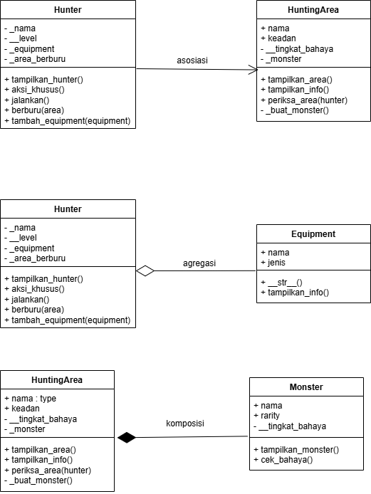
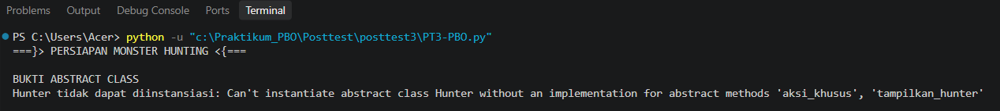
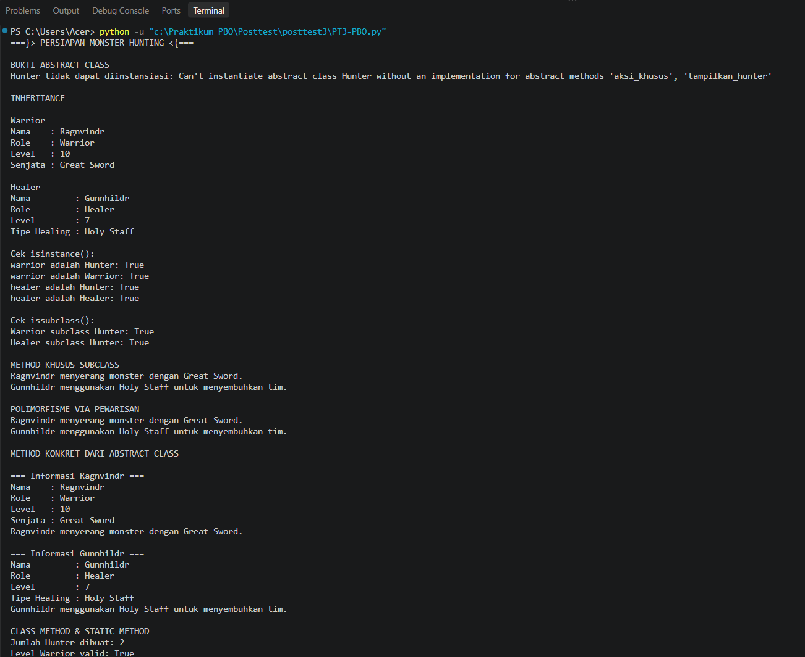
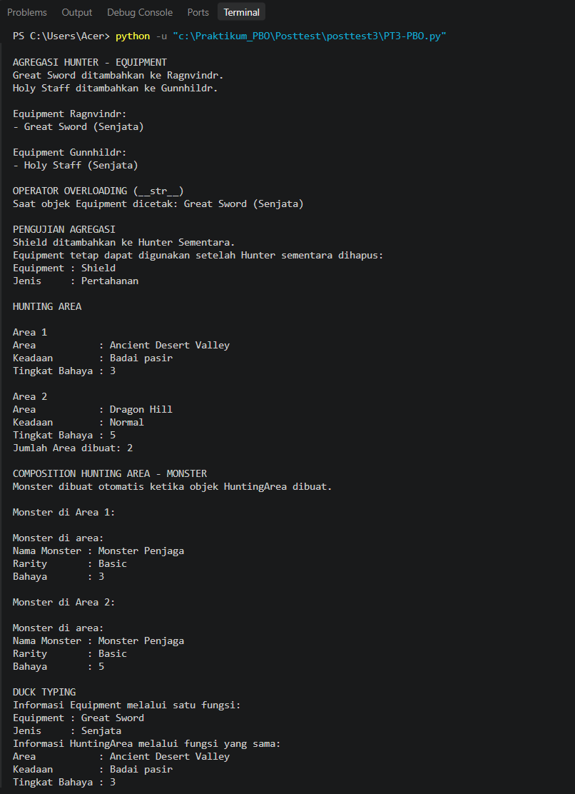
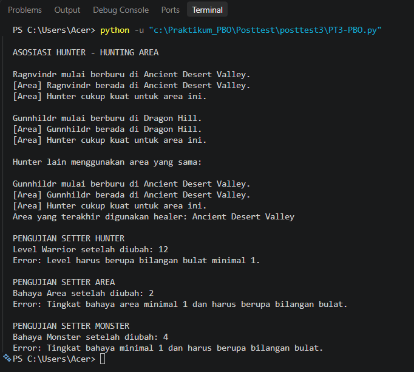

# Persiapan Monster Hunting

Program ini adalah program python sederhana yang mana akan menerapkan konsep Object-Oriented Programming (OOP) dengan tema persiapan tim monster hunting. Pada program ini ada beberapa konsep OOP yang akan digunakan seperti inheritance, abstraksi, enkapsulasi, polimorfisme, duck typing, operator overloading, serta relasi asosiasi, agregasi, dan komposisi.

## Class Diagram



### Penjelasan Relasi Antarclass

1. **Asosiasi —> Hunter dengan HuntingArea:** Hunter dapat menggunakan objek HuntingArea ketika berburu. Hunter dan area berburu dapat dibuat serta digunakan secara terpisah, dan satu area dapat digunakan oleh beberapa Hunter.

2. **Agregasi —> Hunter dengan Equipment:** Hunter menyimpan equipment yang dibuat secara terpisah. Equipment tetap dapat digunakan meskipun Hunter yang sebelumnya memilikinya dihapus, selama objek equipment tersebut masih memiliki referensi. Karena equipment tidak bergantung pada keberadaan Hunter, relasi ini dimodelkan sebagai agregasi. Simbol berlian kosong berada di sisi Hunter.

3. **Komposisi —> HuntingArea dengan Monster:** Ketika objek HuntingArea dibuat, program secara otomatis membuat objek Monster dan menyimpannya sebagai bagian dari area tersebut. Pada rancangan program ini, area berperan sebagai keseluruhan yang mengelola monster. Karena itu, relasi ini dimodelkan sebagai komposisi dengan simbol berlian terisi di sisi HuntingArea.

## Abstraksi

Hunter merupakan abstract class yang menggunakan fasilitas Abstract Base Class dari Python. Class ini memiliki dua abstract method, yaitu tampilkan_hunter dan aksi_khusus. Class Warrior dan Healer mengimplementasikan kedua method tersebut sesuai perilaku masing-masing. Hunter juga memiliki method konkret jalankan yang dapat digunakan bersama oleh semua subclass.

Program mencoba membuat objek langsung dari class Hunter menggunakan penanganan error. Percobaan tersebut menghasilkan TypeError karena Hunter masih memiliki abstract method yang belum diimplementasikan. Pesan error ditampilkan di terminal sebagai bukti bahwa abstract class tidak dapat dibuat menjadi objek secara langsung.

## Polimorfisme

- **Polimorfisme melalui pewarisan:** Warrior dan Healer memiliki implementasi aksi_khusus yang berbeda. Kedua objek dipanggil melalui satu perulangan pada daftar tim hunter, sehingga program tidak perlu memeriksa tipe atau nama role untuk menentukan perilaku objek.

- **Duck typing:** Equipment dan HuntingArea tidak memiliki hubungan pewarisan, tetapi keduanya menyediakan method tampilkan_info. Keduanya dapat diproses oleh fungsi tampilkan_info_umum karena fungsi tersebut hanya membutuhkan objek yang menyediakan method tersebut.

- **Operator overloading:** Equipment memiliki method string khusus yang membuat objeknya dapat ditampilkan dengan format nama dan jenis equipment yang mudah dibaca ketika dicetak.

## Prinsip SOLID

Program menerapkan Open/Closed Principle (OCP) secara sederhana melalui polimorfisme. Jenis Hunter baru dapat ditambahkan sebagai subclass dengan menerapkan method abstrak yang diwajibkan. Perulangan yang memproses anggota tim tetap dapat digunakan tanpa mengubah logika untuk membedakan setiap jenis Hunter.

## Bukti Output Program

Berikut adalah bagian kode pembuktian abstraksi beserta output program untuk pembuktian abstraksi.
```python
print("\nBUKTI ABSTRACT CLASS")
    try:
        Hunter("Hunter Abstrak", 1)
    except TypeError as error:
        print("Hunter tidak dapat diinstansiasi:", error)
```


Berikut adalah Output dari Program OOP ini.



